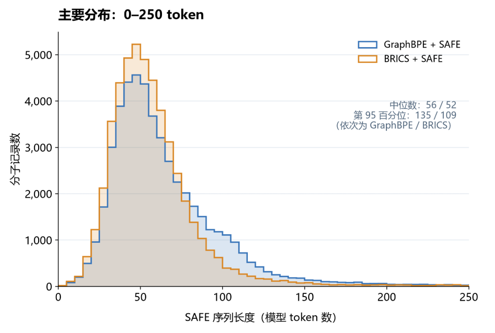
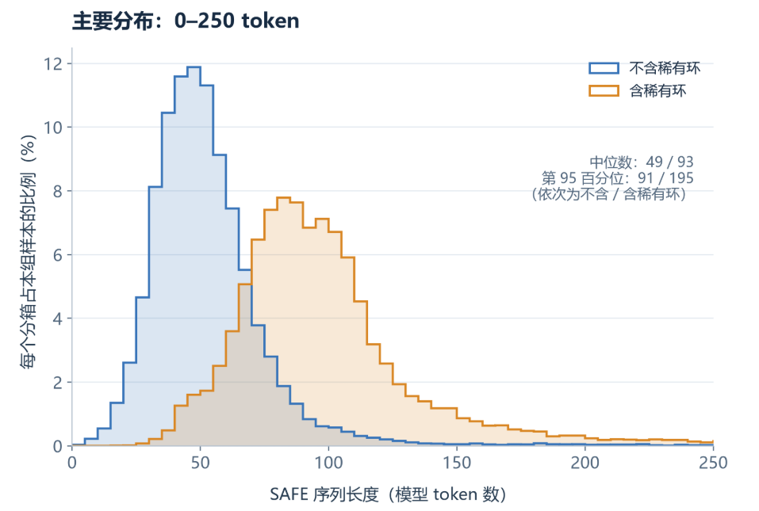
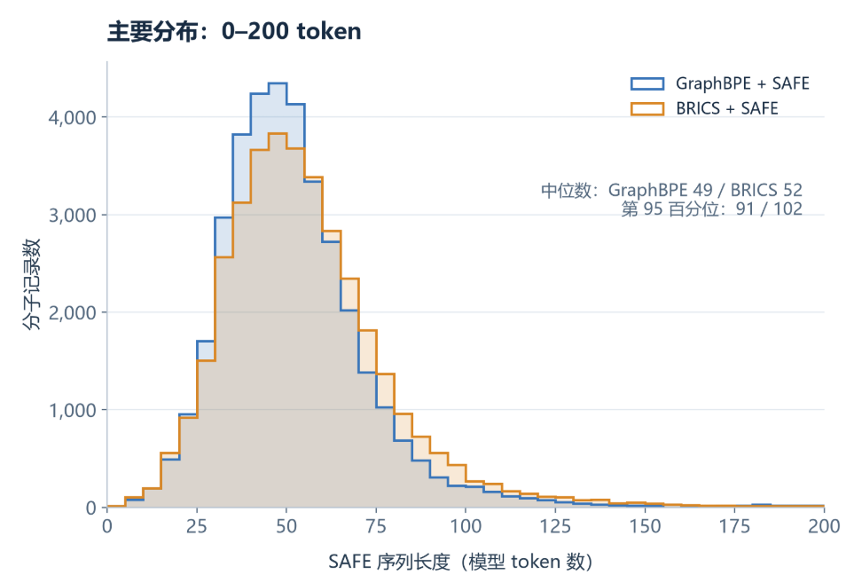

# GraphBPE 与 BRICS：ChEMBL 批量切分及 token 长度比较

本说明针对 `E:\GraphBpe+SAFE\SAFE-main` 当前项目，使用已有的 Conda 环境 `graphbpe-safe`。运行顺序为：准备环境 → BRICS 切分 → GraphBPE 切分 → 比较 SAFE 文本的平均 token 长度。

本文命令使用 Windows CMD / Anaconda Prompt。Python 命令均为单行，终端自动折行不影响执行；不要添加 PowerShell 的反引号。所有数据和脚本参数使用绝对路径，因此无需先 `cd` 到项目目录。

## 1. 脚本与数据位置

| 用途 | 完整路径 |
| --- | --- |
| BRICS 批处理脚本 | `E:\GraphBpe+SAFE\SAFE-main\safe\batch_chembl_brics.py` |
| GraphBPE 批处理脚本 | `E:\GraphBpe+SAFE\SAFE-main\safe\batch_chembl.py` |
| token 长度比较脚本 | `E:\GraphBpe+SAFE\SAFE-main\safe\compare_safe_token_lengths.py` |
| ChEMBL 输入数据 | `E:\GraphBpe+SAFE\SAFE-main\safe\data\chembl_37_chemreps.txt` |
| GraphBPE 切分词表目录 | `E:\GraphBpe+SAFE\SAFE-main\safe\data\tokenizer\vocab3000ring300` |
| SAFE 文本 tokenizer | `E:\GraphBpe+SAFE\SAFE-main\expts\tokenizer\tokenizer-custom.json` |
| 依赖列表 | `E:\GraphBpe+SAFE\SAFE-main\requirements.txt` |

当前 `.txt` 输入文件实际上是带表头的 TSV（制表符分隔）。脚本至少要求 `chembl_id` 和 `canonical_smiles` 两列；当前文件还包含 `standard_inchi` 和 `standard_inchi_key`。脚本根据表头而非扩展名识别分隔符。

## 2. 激活环境

在 Anaconda Prompt 中执行：

```cmd
conda activate graphbpe-safe
python -c "import sys; print(sys.executable)"
```

当前机器应显示：

```text
E:\programming\conda\envs\graphbpe-safe\python.exe
```

如果需要按项目依赖文件安装或补齐依赖，执行：

```cmd
python -m pip install -r "E:\GraphBpe+SAFE\SAFE-main\requirements.txt"
```

已配置好的环境无需每次运行前重复安装。当前依赖文件内容为：

```txt
safe-mol==0.2.0
rdkit==2025.9.1
datamol==0.13.0
numpy==2.5.2
networkx==3.6.1
loguru==0.7.3
tqdm==4.70.1
torch==2.14.1
tokenizers==0.23.3
transformers==5.20.1
huggingface-hub==1.33.0
fsspec==2026.9.0
```

## 3. 运行 BRICS 切分

先处理输入文件前 1000 条数据记录：

```cmd
python -B "E:\GraphBpe+SAFE\SAFE-main\safe\batch_chembl_brics.py" --input "E:\GraphBpe+SAFE\SAFE-main\safe\data\chembl_37_chemreps.txt" --output-dir "E:\GraphBpe+SAFE\SAFE-main\safe\data\output_brics" --workers 1 --batch-size 256 --limit 1000 --delimiter auto --allow-stereo-coarsening
```

该脚本使用 RDKit BRICS 规则提出切分边，再由 SAFE 转换器生成 SAFE 字符串，并检查切分分区和分子重建结果。

输出目录会自动创建：

```text
E:\GraphBpe+SAFE\SAFE-main\safe\data\output_brics
```

## 4. 运行 GraphBPE 切分

使用同一输入文件的前 1000 条数据记录：

```cmd
python -B "E:\GraphBpe+SAFE\SAFE-main\safe\batch_chembl.py" --input "E:\GraphBpe+SAFE\SAFE-main\safe\data\chembl_37_chemreps.txt" --output-dir "E:\GraphBpe+SAFE\SAFE-main\safe\data\output" --vocab-prefix "E:\GraphBpe+SAFE\SAFE-main\safe\data\tokenizer\vocab3000ring300\pretrain-token" --workers 1 --batch-size 256 --limit 1000 --delimiter auto --allow-stereo-coarsening
```

该脚本加载已有的 在前5万条数据中训练的GraphBPE 词表，由 BPE 子图边界提出切分边，再调用 SAFE 转换器生成 SAFE 字符串。运行此命令不会训练新的 GraphBPE 词表。

`--vocab-prefix` 是三个文件共有的路径前缀，不加扩展名。当前所需文件为：

```text
E:\GraphBpe+SAFE\SAFE-main\safe\data\tokenizer\vocab3000ring300\pretrain-token.node
E:\GraphBpe+SAFE\SAFE-main\safe\data\tokenizer\vocab3000ring300\pretrain-token.edge
E:\GraphBpe+SAFE\SAFE-main\safe\data\tokenizer\vocab3000ring300\pretrain-token.ring
```

当前 `batch_chembl.py` 默认指向项目根目录下的 `data\tokenizer`，而实际词表位于 `safe\data\tokenizer`，因此应保留命令中的显式 `--vocab-prefix`。

输出目录会自动创建：

```text
E:\GraphBpe+SAFE\SAFE-main\safe\data\output
```

## 5. 批处理参数说明

| 参数 | 适用脚本 | 默认值 / 是否必填 | 含义 |
| --- | --- | --- | --- |
| `--input` | 两者 | 必填 | 带表头的 CSV/TSV 数据文件路径。至少包含 `chembl_id`、`canonical_smiles`。 |
| `--output-dir` | 两者 | 必填 | 结果保存目录；不存在时自动创建。 |
| `--vocab-prefix` | 仅 GraphBPE | 默认指向项目根目录的 `data\tokenizer\vocab3000ring300\pretrain-token` | GraphBPE 词表公共前缀；代码在后面追加 `.node`、`.edge`、`.ring`。本文命令显式指定实际路径。 |
| `--workers` | 两者 | `1` | 转换工作进程数，必须大于等于 1。`1` 表示串行处理；例如 `4` 使用 4 个工作进程。各工作进程持有自己的转换器，多进程会增加内存占用。 |
| `--batch-size` | 两者 | `256` | 主进程每次读取并提交处理的输入记录数，必须大于等于 1。它是数据处理批量大小，不是模型训练 batch size。 |
| `--limit` | 两者 | `0` | 最多读取多少条数据记录，不含表头。`1000` 为前 1000 条；`0` 为处理全部。失败记录也占用这个限额。 |
| `--delimiter` | 两者 | `auto` | `auto` 根据表头判断：含制表符则按 TSV，否则按逗号分隔。`tab` 强制 TSV，`comma` 强制 CSV。 |
| `--allow-stereo-coarsening` | 两者 | 默认关闭 | 无需填写值的开关。允许 SAFE 的立体保护调整原切分边界；仍要求最终分子重建及分区检查通过。 |
| `-h` / `--help` | 两者 | 可选 | 打印参数列表并退出，不执行切分。 |

命令中的 `-B` 是 Python 参数，用于禁止写入 `.pyc` 字节码缓存，与切分结果无关。

### 立体保护开关如何选择

本文两条命令均加入 `--allow-stereo-coarsening`，与当前已生成结果的设置一致。

- 不加该参数：要求算法提出的切分边与 SAFE 实际使用的切分边完全一致。若 SAFE 因立体保护改变切分边，该记录写入 `failed.jsonl`。
- 加上该参数：允许这种边界变化，可能使最终 SAFE 片段比原切分更粗；仍检查重建后的分子是否保持立体、荷电和同位素信息。该参数不等于忽略立体化学，也不保证每条记录都成功。
- 比较两种方法时，两条命令应采用相同的开关设置。若研究严格保留算法边界的结果，应从两条命令中同时删除该参数。

### 如何处理全量数据

将两条命令中的 `--limit 1000` 都改成 `--limit 0` 即可。需要并行时，可把 `--workers 1` 改成适合机器资源的进程数，例如 `--workers 4`。

同一个输出目录会被重复使用，`safe.txt`、`records.jsonl`、`failed.jsonl` 会在运行时重新写入，`summary.json` 在正常完成后重新写入。保留试验结果时，请给新运行设置不同的 `--output-dir`；中断运行后不要将目录中旧的 `summary.json` 当成本次完成标志。

## 6. 切分结果保存在哪里

按本文命令运行后，两组结果分别保存在：

```text
E:\GraphBpe+SAFE\SAFE-main\safe\data\output\
    safe.txt
    records.jsonl
    failed.jsonl
    summary.json

E:\GraphBpe+SAFE\SAFE-main\safe\data\output_brics\
    safe.txt
    records.jsonl
    failed.jsonl
    summary.json
```

| 文件 | 内容及用途 |
| --- | --- |
| `safe.txt` | 每行一条成功生成的 SAFE 字符串，可作为语料，也供后续 token 长度比较使用。失败记录不会写入。 |
| `records.jsonl` | 每行一个成功记录的 JSON 对象，包含原始记录编号、ChEMBL ID、原始 SMILES、SAFE 编码、切分边、片段分组及检查结果。 |
| `failed.jsonl` | 每行一个失败记录，包含原始标识、`error_type` 和 `error`。没有失败时文件可为空。 |
| `summary.json` | 整次运行的统计，包括处理/成功/失败数量、边界完全一致数量、错误类型、耗时、输入路径和版本。GraphBPE 还保存词表哈希。某些零计数字段可能不出现。 |

`safe.txt` 第 n 行对应同一目录 `records.jsonl` 第 n 条成功记录；如果存在失败，它不一定对应原始输入的第 n 条记录。追溯输入时使用 `record_index`（从 1 开始，不含表头）和 `chembl_id`。

成功记录中的主要切分字段：

| 字段 | 含义 |
| --- | --- |
| `safe` | 最终 SAFE 编码字符串。 |
| `requested_cuts` / `used_cuts` | 原算法提出的切分边 / SAFE 实际接受的切分边。 |
| `safe_groups` / `num_safe_fragments` | 实际 SAFE 片段的原子分组 / 片段数量。 |
| `bpe_groups` / `num_bpe_fragments` | GraphBPE 原始子图分组 / 子图数量，仅 GraphBPE 输出。 |
| `bpe_node_ids` | GraphBPE 子图的词表 ID，仅 GraphBPE 输出；不等于 SAFE 文本 tokenizer 的 ID 序列。 |
| `brics_groups` / `num_brics_fragments` | 原始 BRICS 切分分组 / 片段数量，仅 BRICS 输出。 |
| `bpe_boundary_exact` / `brics_boundary_exact` | 相应算法的提出切分边与实际切分边是否完全一致。 |
| `roundtrip_ok` | 是否通过分子重建一致性检查；写入成功记录时为 `true`。 |

## 7. 比较平均 token 长度

两种方法的切分都结束后，直接读取生成的两份 `safe.txt`：

```cmd
python -B "E:\GraphBpe+SAFE\SAFE-main\safe\compare_safe_token_lengths.py" --project-root "E:\GraphBpe+SAFE\SAFE-main" --tokenizer "E:\GraphBpe+SAFE\SAFE-main\expts\tokenizer\tokenizer-custom.json" --graphbpe "E:\GraphBpe+SAFE\SAFE-main\safe\data\output\safe.txt" --brics "E:\GraphBpe+SAFE\SAFE-main\safe\data\output_brics\safe.txt"
```

当前比较脚本已包含自动保存逻辑：会创建 `comparison` 目录、覆盖写入下列文件，并在终端打印结果和保存位置。无需手动添加 `>`，也没有 `--output` 参数。

```text
E:\GraphBpe+SAFE\SAFE-main\safe\data\comparison\results.json
```

若修改了切分命令的输出目录，也要相应修改比较命令中的 `--graphbpe` 和 `--brics`。比较结果仍保存到 `--project-root` 下的 `safe\data\comparison\results.json`。

| 比较参数 | 默认值 / 是否必填 | 含义 |
| --- | --- | --- |
| `--project-root` | 默认 `E:\GraphBpe+SAFE\SAFE-main` | 本地项目根目录，用于导入项目代码并确定比较结果保存位置。 |
| `--tokenizer` | 必填 | 两份语料共同使用的已训练 tokenizer JSON 文件，也可指定包含 `tokenizer.json` 的目录。 |
| `--graphbpe` | 必填 | GraphBPE 输出的 `safe.txt` 路径。 |
| `--brics` | 必填 | BRICS 输出的 `safe.txt` 路径。 |
| `--add-special-tokens` | 默认关闭 | 无需填写值的开关；添加后计入 tokenizer 配置的特殊 token，例如 `[CLS]`、`[SEP]`。 |
| `-h` / `--help` | 可选 | 查看参数帮助并退出。 |

统计逻辑：对每条非空 SAFE 文本使用同一个 tokenizer 编码，以 ID 列表长度为 token 数，最后计算 `mean_tokens = total_tokens / num_sequences`。默认不计特殊 token、不 padding、不截断，并关闭 BPE dropout。空行被计数后跳过；编码失败会报错终止，不会悄悄丢弃。

GraphBPE 的 `.node/.edge/.ring` 用于分子切分，`tokenizer-custom.json` 用于 SAFE 文本的 tokenization，两类词表不能互相替代。

## 8. 如何读比较结果

| JSON 字段 | 含义 |
| --- | --- |
| `graphbpe.mean_tokens` / `brics.mean_tokens` | 两种 SAFE 表示的平均 token 长度。 |
| `num_sequences` / `total_tokens` | 纳入统计的非空序列数量 / token 总数。 |
| `min_tokens` / `max_tokens` | 单条序列 token 数的最小值 / 最大值。 |
| `unk_tokens` / `sequences_with_unk` | 未知 token 总数 / 含未知 token 的序列数量。 |
| `comparison.graphbpe_minus_brics` | GraphBPE 均值减去 BRICS 均值；负值表示 GraphBPE 更短。 |
| `comparison.graphbpe_reduction_percent` | `(BRICS均值 - GraphBPE均值) / BRICS均值 × 100`；正值表示 GraphBPE 更短，负值表示更长。 |
| `comparison.same_sequence_count` | 两份文件的非空序列数是否相同，不证明分子集合相同。 |
| `comparison.same_molecule_set_verified` | 当前脚本固定写为 `false`，因为它没有读取分子标识进行匹配。 |
| `tokenizer_sha256` | 文本 tokenizer 文件的哈希，用于标识所用词表文件。 |

两种切分方法可能有不同的失败记录。正式比较应使用共同成功的同一批分子；针对同一个输入文件，可按两份 `records.jsonl` 的 `record_index` 对齐并核对分子标识，再统计对应的 `safe` 字段。当前比较脚本不会自动求交集。

平均 token 长度也依赖 tokenizer 的训练语料与词表。报告结果时应说明 tokenizer 来源及特殊 token 设置，不能将某个文本 tokenizer 下的长度直接等同于 GraphBPE 子图数量。

### 已有结果快照

### 字符串长度统计

统计范围为同一批 50,000 条输入记录。字符串长度直接按字符数计算，不使用 tokenizer。

| 指标 | 原始 SMILES | GraphBPE+SAFE | BRICS+SAFE |
| --- | ---: | ---: | ---: |
| 有效记录数 | 50,000 | 49,992 | 49,997 |
| **平均字符数** | **56.60** | **90.48** | **70.94** |
| 中位数 | 46 | 59 | 55 |
| 95% 分位数 | 110 | 229 | 144 |
| 99% 分位数 | 281.01 | 498 | 417 |
| 最小值 | 1 | 1 | 1 |
| 最大值 | 1,230 | 3,442 | 2,192 |
| 总字符数 | 2,830,164 | 4,523,151 | 3,546,663 |

字符数包含字母、数字、括号、点号及其他符号，不计文件换行符和字段分隔符。原始 SMILES 使用输入文件中的 `canonical_smiles` 字段。

GraphBPE 和 BRICS 分别有 8 条和 3 条编码失败记录，其 SAFE 长度留空，不按 0 计入统计。各列基于各自全部有效记录汇总，样本数量略有不同。

### 分子原子数统计

对同一批 50,000 条原始 SMILES 使用 RDKit 2025.09.1 进行解析。

| 指标 | 非氢原子数（重原子） | 包含全部氢原子的总原子数 |
| --- | ---: | ---: |
| **平均值** | **29.94** | **56.06** |
| 中位数 | 26 | 48 |
| 最小值 | 1 | 4 |
| 最大值 | 548 | 1,063 |
| 95% 分位数 | 51 | 101 |

原子数包含每条 SMILES 中的全部组分。重原子数不包含氢原子；总原子数包含显式及隐式氢。两条无法通过 RDKit 解析的记录未计入统计，也未按 0 处理。

### 全部分子的 token 长度比较

统计范围为两种方法均成功编码的 49,991 条分子记录，包含稀有环分子。

| 指标 | GraphBPE+SAFE | BRICS+SAFE |
| --- | ---: | ---: |
| 平均 token 长度 | 68.72 | **60.49** |
| 中位数 | 56 | **52** |
| 95% 分位数 | 135 | **109** |
| 99% 分位数 | 293 | **261.10** |
| 最大 token 长度 | 2,779 | **1,487** |
| 超过 512 token 的记录数 | **133** | 137 |
| 超过 1,024 token 的记录数 | 15 | **3** |
| 总 token 数 | 3,435,435 | **3,023,726** |

在该数据集和 tokenizer 下，GraphBPE+SAFE 比 BRICS+SAFE 平均多 8.24 个 token，平均长度增加约 13.62%。

### 排除稀有环分子后的 token 长度比较

按当前代码对环表进行字符串精确匹配，排除此前识别出的 13,398 条含稀有环分子的记录后，对剩余共同成功的 36,594 条记录进行比较。该组也包含无环分子。

| 指标 | GraphBPE+SAFE | BRICS+SAFE |
| --- | ---: | ---: |
| 平均 token 长度 | **54.85** | 59.27 |
| 中位数 | **49** | 52 |
| 95% 分位数 | **91** | 102 |
| 最大 token 长度 | **1,026** | 1,487 |
| 超过 512 token 的记录数 | **52** | 92 |

排除上述稀有环分子后，GraphBPE+SAFE 比 BRICS+SAFE 平均少 4.42 个 token，平均长度降低约 7.46%。

### Token 减少比例最高的前 10 个分子

在 GraphBPE 和 BRICS 均成功编码的 49,991 条分子记录中，按 token 减少比例降序排列，包含稀有环分子。

减少比例 =（BRICS token 数 − GraphBPE token 数）/ BRICS token 数 × 100%。


| 排名 | 分子 ID | 原始 SMILES | GraphBPE SAFE | BRICS SAFE | GraphBPE token 数 | BRICS token 数 | token 减少量 | 减少比例 |
| ---: | --- | --- | --- | --- | ---: | ---: | ---: | ---: |
| 1 | CHEMBL16264 | `CCOCC` | `CCOCC` | `CC1.O12.C2C` | 5 | 11 | 6 | 54.55% |
| 2 | CHEMBL503858 | `CCCCCCCCCCCCOCCOCCOCCOCCOCCOCCOCCOCCOCCOCCOCCOCCOCCOCCOCCOCCOCCOCCOCCOCCOCCOCCOCCOCCOCCO` | `C1COCCOCCOCCO2.C2COCCOCCOCCO3.C3COCCOCCOCCO4.C4COCCOCCOCCO5.C5COCCOCCOCCO6.C6COCCOCCOCCO7.CCCCCCCCCC1.C7COCCO` | `CCCCCCCCCCCC1.C%12C%23.C%34C%45.C%47C%48.C%49C%50.C2C3.C4C5.C6C7.C8C9.C%10C%11.C%13C%14.C%15C%16.C%17C%18.C%19C%20.C%21C%22.C%24C%25.C%26C%27.C%28C%29.C%30C%31.C%32C%33.C%35C%36.C%37C%38.C%39C%40.C%41C%42.C%43C%44.C%46CO.O1%12.O%23%34.O%45%47.O%48%49.O%502.O34.O56.O78.O9%10.O%11%13.O%14%15.O%16%17.O%18%19.O%20%21.O%22%24.O%25%26.O%27%28.O%29%30.O%31%32.O%33%35.O%36%37.O%38%39.O%40%41.O%42%43.O%44%46` | 109 | 238 | 129 | 54.20% |
| 3 | CHEMBL1077246 | `CCCCCCCCCCCCCCCC(=O)N[C@@H](CSC[C@@H](COC(=O)CCCCCCCCCCCCCCC)OC(=O)CCCCCCCCCCCCCCC)C(=O)N[C@@H](C)C(=O)NCC(=O)NCCOCCOCCOCCOCCOCCOCCOCCOCCOCCOCCOCCOCCOCCOCCOCCOCCOCCOCCOCCOCCOCCOCCOCCOCCOCCOCCOCCOCCOCCOCCOCCOCCOCCOCCOCCOCCOCCOCCOCCOCCOCCOCCOCCOCCOC` | `CCCCCCCCCCCCCC1.C%15CCCCCCCCCCCCC.C%17CCCCCCCCCCCCC.C%20COCCOCCOCCO2.C2COCCOCCOCCO3.C3COCCOCCOCCO4.C4COCCOCCOCCO5.C5COCCOCCOCCO6.C6COCCOCCOCCO7.C7COCCOCCOCCO8.C8COCCOCCOCCO9.C9COCCOCCOCCO%10.C%10COCCOCCOCCO%11.C%11COCCOCCOCCO%13.C1C(=O)N[C@H]%18C%12.C%19(=O)NCC(=O)N%20.S%12C[C@H]%16C%14.C%18(=O)N[C@H]%19C.O%14C(=O)C%15.O%16C(=O)C%17.C%13COC` | `CCCCCCCCCCCCCCCC%27=O.C1(=O)CCCCCCCCCCCCCCC.C%16(=O)CCCCCCCCCCCCCCC.[C@H]%(102)(C5)C%38=O.C6[C@H]%82C%71.[C@H]%(103)(C)C%49=O.C3C%60=O.C4C%93.C2C7.C8C9.C%10C%11.C%12C%13.C%14C%15.C%17C%18.C%19C%20.C%21C%22.C%23C%24.C%25C%26.C%28C%29.C%30C%31.C%32C%33.C%34C%35.C%36C%37.C%39C%40.C%41C%42.C%43C%44.C%45C%46.C%47C%48.C%50C%51.C%52C%53.C%54C%55.C%56C%57.C%58C%59.C%61C%62.C%63C%64.C%65C%66.C%67C%68.C%69C%70.C%72C%73.C%74C%75.C%76C%77.C%78C%79.C%80C%81.C%83C%84.C%85C%86.C%87C%88.C%89C%90.C%91C%92.C%94C%95.C%96C%97.C%98C%99.C%(100)C%(101).N%27%(102).S56.O1%71.O%16%82.N%38%(103).N%493.N%604.O%932.O78.O9%10.O%11%12.O%13%14.O%15%17.O%18%19.O%20%21.O%22%23.O%24%25.O%26%28.O%29%30.O%31%32.O%33%34.O%35%36.O%37%39.O%40%41.O%42%43.O%44%45.O%46%47.O%48%50.O%51%52.O%53%54.O%55%56.O%57%58.O%59%61.O%62%63.O%64%65.O%66%67.O%68%69.O%70%72.O%73%74.O%75%76.O%77%78.O%79%80.O%81%83.O%84%85.O%86%87.O%88%89.O%90%91.O%92%94.O%95%96.O%97%98.O%99%(100).O%(101)C` | 286 | 571 | 285 | 49.91% |
| 4 | CHEMBL54723 | `CCNCCNCC` | `C1CNCC.CCN1` | `C2C3.CC1.N12.N34.C4C` | 11 | 20 | 9 | 45.00% |
| 5 | CHEMBL609 | `NCCNCCNCCN` | `C1CNCCN.NCCN1` | `NCC1.C2C3.C4CN.N12.N34` | 13 | 22 | 9 | 40.91% |
| 6 | CHEMBL47248 | `OCCNCCNCCO` | `C1CNCCO.OCCN1` | `OCC1.C2C3.C4CO.N12.N34` | 13 | 22 | 9 | 40.91% |
| 7 | CHEMBL18610 | `CCNCCCN(CC)CCCCN(CC)CCCNCC` | `C2CCCN3CC.C1CCN2CC.C3CCNCC.CCN1` | `C6CCC7.C3CC4.C9CC%10.N456.N789.CC1.N13.C5C.C8C.N%102.C2C` | 31 | 52 | 21 | 40.38% |
| 8 | CHEMBL14152 | `CCOC(C)=O` | `CCOC(C)=O` | `C1(C)=O.CC2.O12` | 9 | 15 | 6 | 40.00% |
| 9 | CHEMBL14013 | `CCNCc1ccccc1.Cl` | `CCNCc1ccccc1.Cl` | `c14ccccc1.CC2.N23.C34.Cl` | 14 | 23 | 9 | 39.13% |
| 10 | CHEMBL540483 | `O=c1cc(-c2ccc(OCCOCCOCCOCCOCCOCCOCCOCCOCCOCCOCCOCCOCCOc3ccc(-c4cc(=O)c5ccccc5o4)cc3)cc2)oc2ccccc12` | `C7COCCOCCOCCO8.C8COCCOCCOCCO9.C9COCCOCCOCCO%10.O=c1cc6oc2ccccc12.c1%11cc(=O)c2ccccc2o1.C%10COc1ccc%11cc1.c16ccc(O7)cc1` | `O=c1cc%27oc2ccccc12.c1%29cc(=O)c2ccccc2o1.c1%27ccc%25cc1.c1%26ccc%29cc1.C6C%17.C%28C%30.C%31C%32.C%33C%34.C%35C7.C8C9.C%10C%11.C%12C%13.C%14C%15.C%16C%18.C%19C%20.C%21C%22.C%23C%24.O6%25.O%17%28.O%30%31.O%32%33.O%34%35.O78.O9%10.O%11%12.O%13%14.O%15%16.O%18%19.O%20%21.O%22%23.O%24%26` | 110 | 180 | 70 | 38.89% |

两种 SAFE 表示使用相同的 tokenizer 计算 token 数，不添加特殊 token、不填充、不截断。原始 SMILES 来自输入文件的 canonical_smiles 字段，全部字符串完整保留。减少比例相同时按原始记录编号升序排列。

以上为减少比例最高的个例，不代表整个数据集的平均表现。

完整的top100分子数据存放于"SAFE-main\safe\data\comparison\top100_token_savings.json"

### 全部分子的 token 长度分布



GraphBPE+SAFE 和 BRICS+SAFE 的中位数分别为 56 和 52 token，95% 分位数分别为 135 和 109 token。图中展示 0–250 token 的主要分布区间，纵轴为分子记录数。

### GraphBPE+SAFE：含稀有环与不含稀有环分子的比较



不含稀有环组和含稀有环组的中位数分别为 49 和 93 token，95% 分位数分别为 91 和 195 token。由于两组样本量不同，纵轴按各组样本总数归一化为百分比。

### 排除稀有环分子后的 token 长度分布



GraphBPE+SAFE 和 BRICS+SAFE 的中位数分别为 49 和 52 token，95% 分位数分别为 91 和 102 token。图中展示 0–200 token 的主要分布区间，纵轴为分子记录数。

三张图的分箱宽度均为 5 token。稀有环按当前代码对环表进行字符串精确匹配定义，不含稀有环组也包含无环分子。图中仅放大展示主要区间，统计时未截断长序列。

## 9. 常见问题

### CMD 报 `unrecognized arguments: ` 后跟反引号

这是把 PowerShell 换行符粘贴到了 CMD。使用本文提供的单行命令即可；CMD 若要手动换行，应使用 `^`，不要使用反引号。

### 找不到 GraphBPE 词表

确认 `--vocab-prefix` 指向 `E:\GraphBpe+SAFE\SAFE-main\safe\data\tokenizer\vocab3000ring300\pretrain-token`，不带扩展名，并确认三个词表文件均存在。

### `cannot import name 'attr_as' from 'safe.utils'`

工具函数现已统一到 `safe\utils\__init__.py`，避免同名的 `safe\utils.py` 被 `safe\utils\` 包遮蔽。`attr_as`、`MolSlicer` 等原有 API 均通过 `safe.utils` 访问，GraphBPE 的 `safe.utils.token` 子模块也保留在同一包中。复制项目时请保留完整的 `safe\utils\` 文件夹。

### 切分进度结束但有失败记录

查看对应输出目录的 `failed.jsonl` 和 `summary.json`。非法或空 SMILES、带原子映射或通配原子的输入、严格模式下切分边界发生变化、分区或重建检查失败等，都会导致记录失败。不能仅凭进度到达 100% 判断所有分子都成功。

## 10. 本说明的核对范围

本文依据当前本地脚本与数据路径编写；两个批处理脚本的 `--help` 均已成功执行，输入表头、三个 GraphBPE 词表文件、自动保存比较结果的代码及已有结果文件均已核对。本次文档编写未重新运行批量切分，也未覆盖原有切分结果。

## 从 GitHub 下载完整数据（Git LFS）

本仓库使用 Git LFS 保存两份 ChEMBL 原始文件，以及 GraphBPE、BRICS 各自的 `records.jsonl` 和 `safe.txt`，共 6 个文件，约 1.70 GB。其余代码、词表、摘要和比较结果使用普通 Git 保存。

安装 Git LFS 后，在 CMD / Anaconda Prompt 中执行：

```cmd
git lfs install
git clone https://github.com/zeyuanyu195-design/molecular-tokenizer.git
cd molecular-tokenizer
git lfs pull
git lfs ls-files
```

如果已经克隆仓库，在仓库目录中运行 `git lfs pull` 即可补齐数据。建议使用 Git + Git LFS 获取项目；网页上的文件预览或 ZIP 下载是否包含完整 LFS 对象取决于仓库设置。

LFS 下载后的文件仍在 `safe/data/` 原目录中，批处理命令无需改变文件格式。本文前面的绝对路径针对原始本机目录；如果克隆到了其他位置，请将命令中的项目根目录替换为实际克隆位置。原始数据和切分结果可在本地继续使用，勿把只有几行内容的 LFS 指针文件当成完整数据。

重复上传修改后的大文件会增加 LFS 存储用量；下载完整数据会消耗仓库所有者的 LFS 下载额度。GitHub 的用量和计费说明见 https://docs.github.com/en/billing/concepts/product-billing/git-lfs 。
